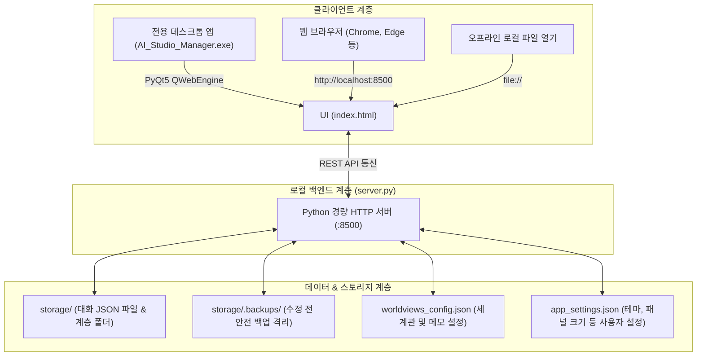

# 📘 Google AI Studio JSON Manager — 전체 기능 정의 및 사용 설명서 (Full Manual)

> **문서 목적:** 본 문서는 Google AI Studio Prompt & Chunk Manager의 전체 아키텍처, 핵심 기능, 세부 UI 구성, REST API 명세 및 사용 가이드를 총망라한 종합 매뉴얼입니다. 다른 대화 세션의 AI 어시스턴트나 개발자, 사용자에게 프로젝트의 전체 기능을 인수인계하고 설명할 때 그대로 제공할 수 있도록 작성되었습니다.

---

## 📑 목차
1. [프로젝트 개요 및 탄생 배경](#1-프로젝트-개요-및-탄생-배경)
2. [시스템 아키텍처 및 3가지 실행 모드](#2-시스템-아키텍처-및-3가지-실행-모드)
3. [인터페이스 레이아웃 구성](#3-인터페이스-레이아웃-구성)
4. [핵심 기능 1: 대화 피드 & 스마트 청크 편집](#4-핵심-기능-1-대화-피드--스마트-청크-편집)
5. [핵심 기능 2: 대화 비교 세션 (Compare Mode)](#5-핵심-기능-2-대화-비교-세션-compare-mode)
6. [핵심 기능 3: 대화 계통도 & 브랜치 맵 (Branch Off & Git Graph)](#6-핵심-기능-3-대화-계통도--브랜치-맵-branch-off--git-graph)
7. [핵심 기능 4: 부모-자식 대화 상속 및 자동 동기화 엔진 (Sync Engine)](#7-핵심-기능-4-부모-자식-대화-상속-및-자동-동기화-엔진-sync-engine)
8. [핵심 기능 5: 대화 세션 브라우저 & 세션 메모(시놉시스) 시스템](#8-핵심-기능-5-대화-세션-브라우저--세션-메모시놉시스-시스템)
9. [핵심 기능 6: 통합 검색 & 단어 일괄 치환 (Batch Find & Replace)](#9-핵심-기능-6-통합-검색--단어-일괄-치환-batch-find--replace)
10. [핵심 기능 7: 세계관(Worldview) 태깅 및 파일 분류](#10-핵심-기능-7-세계관worldview-태깅-및-파일-분류)
11. [핵심 기능 8: 대용량 보관함(storage) & 백업 격리 시스템](#11-핵심-기능-8-대용량-보관함storage--백업-격리-시스템)
12. [핵심 기능 9: 시각 경험 & 12종 테마 / 커스텀 폰트](#12-핵심-기능-9-시각-경험--12종-테마--커스텀-폰트)
13. [핵심 기능 10: 네비게이션 & 스냅 틱 레일 (Tick Rail)](#13-핵심-기능-10-네비게이션--스냅-틱-레일-tick-rail)
14. [백엔드 REST API 엔드포인트 명세](#14-백엔드-rest-api-엔드포인트-명세)
15. [데이터 스펙 및 설정 파일 구조](#15-데이터-스펙-및-설정-파일-구조)
16. [단축키 & 생산성 가이드](#16-단축키--생산성-가이드)

---

## 1. 프로젝트 개요 및 탄생 배경

### 1.1 개요
Google AI Studio에서 작업한 장문의 프롬프트와 대화 세션을 Export한 `.json` 파일을 마치 실제 웹 서비스 인터페이스처럼 아름답게 시각화하고, 청크 단위로 자유롭게 편집, 복제, 분기(Branch Off), 비교(Compare), 검색, 일괄 치환할 수 있는 **올인원 프롬프트 엔지니어링 & 대화 세션 관리 플랫폼**입니다.

### 1.2 핵심 개발 배경 및 해결 과제
1. **Google AI Studio의 한계 극복:**
   - AI Studio 웹에서는 대화가 길어지면 브라우저가 느려지고, 특정 청크만 골라 편집하거나 분기(Branch)된 파일 간의 차이점을 파악하기 어렵습니다.
   - 본 프로그램은 로컬 환경에서 수백 개의 청크를 가진 수십 MB 대용량 파일도 렉 없이 부드럽게 렌더링하고 관리합니다.
2. **외부 AI 코딩 어시스턴트의 토큰 낭비 방지:**
   - 로컬 작업 공간에 대용량 대화 JSON 파일이 있으면 AI 코딩 도구(Cursor, Windsurf, Copilot, Gemini 등)가 프로젝트를 스캔할 때 수백만 토큰을 소모하거나 할당량이 급속도로 고갈됩니다.
   - 이를 원천 차단하기 위해 대용량 파일은 `.gitignore`와 `.cursorignore`로 완벽 격리된 **`storage/`** 전용 디렉터리에서 관리합니다.
3. **대화 파생(Branch Off)의 계통 추적 및 최신화:**
   - 대화 도중 특정 지점에서 가지를 쳐서 파생된 여러 세션들이 있을 때, 어떤 파일이 원본(부모)이고 어디서 갈라졌는지(LCP 분석), 부모의 앞부분 대화가 수정되었을 때 자식 파일들에게 최신 내용을 일괄 전파(Propagate)하거나 연동(Sync)하는 강력한 엔진을 내장했습니다.

---

## 2. 시스템 아키텍처 및 3가지 실행 모드

프로그램은 사용 환경에 따라 3가지 방식으로 자유롭게 구동됩니다.



### 2.1 독립 데스크톱 프로그램 모드 (추천 ⭐)
- **실행 파일:** `AI_Studio_Manager.exe` (초경량 C 런처) 또는 `launch_app.vbs` / `launch_app.bat` / `app.pyw`
- **특징:**
  - 웹 브라우저의 주소창, 탭바 없이 순수한 네이티브 애플리케이션 창으로 실행됩니다.
  - PyQt5 (`PyQtWebEngine`) 기반으로 하드웨어 가속 렌더링 및 네이티브 단축키(`F11` 전체화면, `F12` DevTools, `Ctrl+R` 새로고침 등)를 지원합니다.
  - 파일 다운로드 시 내 PC의 `Downloads` 폴더에 즉시 연동됩니다.

### 2.2 웹 서버 모드 (`run.bat`)
- **실행 파일:** `run.bat`
- **특징:**
  - Python 3 표준 라이브러리(`http.server`, `urllib`, `json` 등)만으로 100% 작동하여 **추가 pip 패키지 설치가 전혀 필요 없습니다.**
  - `http://localhost:8500` 포트로 로컬 서버가 구동되며 기본 웹 브라우저가 자동으로 열립니다.

### 2.3 단독 오프라인 뷰어 모드 (`index.html`)
- **실행 파일:** `index.html` 더블 클릭
- **특징:**
  - 파이썬이 설치되지 않은 환경에서도 브라우저에서 직접 열어 로컬 JSON 파일을 열람하고 편집할 수 있습니다. (서버 모드 기능은 로컬 브라우저 저장소로 대체)

---

## 3. 인터페이스 레이아웃 구성

화면은 작업 효율을 극대화하기 위해 다중 분할 반응형 패널로 설계되어 있습니다.

```
+-----------------------------------------------------------------------------------------+
| [상단 헤더] 📁 파일명(클릭 시 수정) | 🌍 세계관 태그 | 🎨 테마 | [피드|비교|계통도|세션|검색] 탭 | 설정/저장 |
+-----------+-------------------------------------------------------------+---------------+
| [좌측]     | [중앙 메인 스테이지]                                         | [우측]        |
| JSON      |                                                             | Run Settings  |
| 보관함    | - 대화 피드 (청크 카드 목록, 인-피드 분기 배너)               | (파라미터)    |
| (storage) | - 대화 비교 모드 (Pane A / Pane B 듀얼 뷰)                  |               |
| 트리 뷰   | - 대화 계통도 (Git Graph 트리)                              | [너비 드래그] |
|           | - 세션 브라우저 (카드 그리드 뷰)                            |               |
| [폭 조절] | - 검색 & 단어 일괄 치환 세션                                | (240~750px)   |
| (0~500px) +-------------------------------------------------------------+               |
|           | [하단 프롬프트 바] Pending Input (다음 사용자 입력창)          |               |
|           | [높이 드래그 조절 가능 (85~480px)]                          |               |
+-----------+-------------------------------------------------------------+---------------+
```

1. **상단 고정 헤더 (Header):**
   - 현재 활성 파일 경로 및 제목 표시 (클릭 시 파일명 및 세션 메모 즉시 수정 모달 오픈)
   - 세계관(Worldview) 분류 뱃지
   - 뷰 전환 탭: `[💬 대화 피드]` / `[⚖️ 대화 비교]` / `[🌿 대화 계통도]` / `[🗂️ 세션 브라우저]` / `[🔍 검색 세션]`
   - 청크 스텝 슬라이더 & 숫자 이동 인풋
   - 전체 접기/펼치기 토글, 편집 모드 토글
   - 테마 선택 셀렉터 (12종)
   - 저장(`Ctrl+S`), 내보내기, 복사, 폰트 관리 버튼
2. **좌측 사이드바 (JSON 보관함 - Storage Tree):**
   - `storage/` 디렉터리의 다계층 폴더 및 파일 트리 시각화
   - 폴더별 하위 문서 총 개수 재귀 카운트 표시
   - 폴더 생성, 이름 변경, 이동, 삭제
   - 파일 이름 변경, 폴더 간 이동, 삭제
   - 세션 메모 요약 인라인 노출
   - 깔끔한 UI를 위해 파일명에서 `.json` 확장자 자동 숨김 처리
   - 대화 비교 창으로 직접 드래그 앤 드롭 지원
3. **중앙 메인 스테이지 (Main Stage):**
   - 선택한 탭에 따라 피드 / 비교창 / 계통도 / 세션 카드 / 검색창이 전환되며 부드럽게 스크롤
   - 우측에 스냅 틱 레일(Tick Rail) 플로팅 제공
4. **우측 파라미터 패널 (Run Settings):**
   - 모델 선택(Gemini 1.5 Pro, Flash, Gemini 2.0 등)
   - Temperature, TopP, TopK, System Instructions, Safety Settings 편집
   - 좌측 경계선을 마우스로 드래그하여 패널 너비(240px ~ 750px) 자유 조절
5. **하단 대기 입력창 (Pending Input Bar):**
   - 다음 사용자 프롬프트 작성
   - 상단 경계선을 마우스로 드래그하여 높이(85px ~ 480px) 자유 조절

---

## 4. 핵심 기능 1: 대화 피드 & 스마트 청크 편집

### 4.1 청크 카드 렌더링 및 마크다운 지원
- **청크 구분:** `USER` (파랑), `MODEL` (초록), `THINKING / Thought` (보라)로 시각적 완벽 구분
- **GFM 마크다운 엔진:** 테이블, 체크리스트, 취소선, 인라인 코드, 펜스 코드 블록 문법 강조를 완벽 렌더링
- **줄바꿈 자동 보존:** `marked.js`에 `breaks: true`를 적용하여 원문 대화의 엔터/줄바꿈을 100% 손실 없이 보존
- **텍스트 선택 편의성:** 더블클릭 시 편집창으로 바뀌는 오동작을 제거하여 장문 텍스트 드래그 및 복사가 매우 편안함

### 4.2 청크 개별 접기/펼치기 & 첫 문장 한 줄 요약 프리뷰
- 모든 청크 카드의 좌측 화살표(`▼`/`▶`)를 눌러 개별적으로 접고 펼칠 수 있습니다.
- 청크가 접히면 본문은 숨겨지고 카드 상단 헤더에 **첫 문장 한 줄 미리보기 요약(`"..."`)**이 깔끔하게 표시됩니다.
- **Thinking 자동 접힘:** 수천 줄에 달하는 생각 과정(CoT) 블록은 파일 로드 시 자동으로 닫힌 상태로 시작되어 스크롤 압박을 제거합니다.
- **상단 툴바 `[모두 접기 / 모두 펼치기]`:** 수십 개의 긴 청크도 단 한 번의 클릭으로 목차 형태로 요약하거나 전체를 펼칠 수 있습니다.

### 4.3 청크 스마트 편집 & 인터랙티브 삽입
- **개별 편집:** 헤더의 연필 아이콘(`✏️`)을 누르면 해당 청크만 즉시 편집 텍스트에리어로 전환됩니다.
- **전체 편집 모드:** 상단 툴바의 `[텍스트 편집 모드]` 버튼으로 모든 청크를 일괄 편집창으로 열 수 있습니다.
- **인터랙티브 청크 삽입:** 청크와 청크 사이의 빈 공간에 마우스를 올리면 `[+User] [+Model] [+Thought]` 버튼이 나타나 원하는 위치에 새로운 대화를 즉시 끼워 넣을 수 있습니다.
- **드래그 앤 드롭 순서 변경:** 청크 카드의 드래그 핸들을 잡고 위아래로 끌어 대화 순서를 직관적으로 바꿀 수 있습니다.
- **삭제 및 복구(휴지통):** 청크 삭제 시 휴지통에 보관되며, 상단 휴지통 뱃지를 통해 언제든지 원래 위치로 복원할 수 있습니다.

---

## 5. 핵심 기능 2: 대화 비교 세션 (Compare Mode)

Google AI Studio의 Compare Mode처럼 **두 개의 JSON 대화 파일을 좌우에 나란히 펼쳐놓고 실시간으로 비교하고 동시에 편집**할 수 있는 듀얼 뷰 기능입니다.

```
+-----------------------------------------------------------------------------------------+
| [대화 비교 세션 툴바] ↔ 좌우 맞바꾸기 | 🔄 동기 스크롤 ON/OFF | ⚡ 12번 청크까지 일치 | 점프: [# ] |
+--------------------------------------------+--------------------------------------------+
| [대화 A] 소설_초안 (총 25개 청크) [저장]   | [대화 B] 소설_퇴고본 (총 28개 청크) [저장] |
+--------------------------------------------+--------------------------------------------+
| [청크 #1] USER           ✓ 일치 (에메랄드) | [청크 #1] USER           ✓ 일치 (에메랄드) |
| ...                                        | ...                                        |
| [청크 #12] MODEL         ✓ 일치            | [청크 #12] MODEL         ✓ 일치            |
+--------------------------------------------+--------------------------------------------+
| [청크 #13] USER       ⚡ 첫 분기점 (앰버)  | [청크 #13] USER       ⚡ 첫 분기점 (앰버)  |
| "주인공의 결정을 바꾼다"                   | "주인공이 원래 계획을 고수한다"            |
| [B로 복사 ->]                              | [<- A로 복사]                              |
+--------------------------------------------+--------------------------------------------+
| [청크 #14] MODEL       ✎ 내용 다름 (보라)  | [청크 #14] MODEL       ✎ 내용 다름 (보라)  |
+--------------------------------------------+--------------------------------------------+
```

### 5.1 파일 선택 및 로드
- **보관함 선택 모달:** 비교창 상단의 파일 선택 버튼을 누르면 검색창이 포함된 모달이 열려 보관함의 파일을 원클릭으로 지정할 수 있습니다.
- **사이드바에서 직접 로드:** 좌측 보관함 트리의 각 파일 행에 있는 `[A]`, `[B]` 버튼을 누르거나, 마우스로 원하는 창에 드래그 앤 드롭하면 즉시 로드됩니다.
- **로컬 PC 파일 열기:** PC에 저장된 JSON 파일을 모달에서 직접 업로드하여 비교할 수도 있습니다.

### 5.2 스마트 Diff 하이라이트
- **`✓ 일치` (에메랄드 테두리):** 내용이 완전히 동일한 청크 구간
- **`⚡ 첫 분기점` (앰버 뱃지 & 경고 강조):** 대화 내용이 갈라지기 시작하는 최초의 청크 번호
- **`✎ 내용 다름` (보라색 테두리):** 분기점 이후 서로 내용이 달라진 청크
- **`+ 추가 청크` (스카이블루 테두리):** 한쪽 대화에만 더 길게 이어지는 초과 청크

### 5.3 강력한 인터랙션 & 편집 기능
- **양쪽 독립 편집 & 저장:** 좌측(A)과 우측(B) 대화의 모든 청크를 각각 마크다운/편집 모드로 전환하여 실시간으로 고치고, 각 창 상단의 `[저장]` 버튼으로 개별 저장할 수 있습니다.
- **원클릭 교차 복사:** 마음에 드는 상대방 청크를 클릭 한 번으로 내 대화창의 동일 위치로 즉시 복사 삽입(`B로 복사 ->`, `<- A로 복사`)할 수 있습니다.
- **동기 스크롤 (Sync Scroll):** 스크롤 동기화 버튼을 켜면 한쪽을 내릴 때 반대쪽도 비례하여 함께 움직여 긴 대화의 맥락 비교가 수월합니다.
- **청크 번호 직접 입력 점프:** 슬라이더 대신 숫자 인풋에 청크 번호를 입력하면 해당 위치로 양쪽 또는 개별 창이 즉시 스크롤 점프합니다.
- **좌우 맞바꾸기 (`↔` Swap):** A와 B 파일의 위치를 클릭 한 번으로 맞바꿉니다.

---

## 6. 핵심 기능 3: 대화 계통도 & 브랜치 맵 (Branch Off & Git Graph)

대화가 길어지면서 여러 갈래로 분기된 파일들의 파생 관계를 GitHub 커밋 그래프처럼 시각화합니다.

### 6.1 원클릭 가지치기 (Branch Off)
- 대화 피드를 읽다가 마음에 드는 청크 카드의 **`[🌿 분기]`** 버튼을 클릭합니다.
- 모달이 열리며 시작 대화부터 해당 청크 지점까지만 깔끔하게 복사된 새 JSON 파일명을 추천합니다.
- 저장 위치(보관함 서브폴더)를 선택하고 확인을 누르면 새 분기 파일이 생성되며 즉시 그 파일로 전환됩니다.

### 6.2 LCP(최장 공통 접두사) 기반 패밀리 그룹화
- 보관함 내 모든 대화 파일의 첫 프롬프트와 청크 해시를 고속 분석하여, 동일한 시작 대화에서 파생된 파일들을 하나의 **대화 그룹(Family)**으로 자동 묶어줍니다.
- 상단 `[🌿 대화 계통도]` 탭에서 전체 패밀리 카드와 계통도를 한눈에 검색하고 파악할 수 있습니다.
- **Main Trunk vs Branch:** 가장 먼저 만들어졌거나 가장 길이가 긴 원본 파일에는 `M (Main Trunk)` 뱃지를, 파생 파일에는 `B (Branch)` 뱃지를 부여합니다.

### 6.3 인-피드 분기 배너 (In-Feed Fork Banner)
- 피드를 스크롤할 때 현재 파일에서 다른 파일로 갈라져 나간 지점이 발견되면, 청크 카드 사이에 **Git 스타일의 분기점 배너**가 나타납니다.
- "이 지점에서 갈라진 브랜치 N개" 정보와 달라진 질문 미리보기를 제공하며, 클릭 시 해당 브랜치 파일로 즉시 이동합니다.

---

## 7. 핵심 기능 4: 부모-자식 대화 상속 및 자동 동기화 엔진 (Sync Engine)

브랜치 분기 이후 부모(원본) 파일의 앞부분 대화 내용을 수정했을 때, 자식 파일들이 옛날 대화에 머물러 내용 불일치가 발생하는 문제를 완벽하게 해결합니다.

### 7.1 상속 구간과 고유 대화의 시각적 분리
- 자식 파일을 열면 상단에 **부모-자식 상속 배너 (`#inheritedLineageBanner`)**가 표시됩니다.
- 공통 대화 청크 구간(#1 ~ #N)과 현재 파일만의 고유 대화 구간(#N+1 ~ 끝)을 명확하게 구분해 주며, 피드 중간에 에메랄드색 **고유 대화 분기 경계선**이 배치됩니다.
- **초기 로딩 최적화:** 부모로부터 상속받은 수십 개의 청크는 기본적으로 접혀 있으며, 고유 대화부터 펼쳐져 렌더링 렉을 90% 이상 제거합니다.

### 7.2 최신 부모 내용으로 연동 (Sync Lineage)
- 부모 파일의 내용이 변경되면 자식 파일 상단 배너에 **`⚠️ 부모 내용 변경됨`** 경고 뱃지와 함께 `[최신 부모 내용으로 연동]` 버튼이 나타납니다.
- 클릭 시 자식의 고유 대화는 100% 안전하게 보존하면서 부모로부터 상속받은 앞부분 구간만 부모의 최신 청크로 교체 업데이트합니다.

### 7.3 하위 세션 일괄 전파 (Propagate Lineage)
- 반대로 부모 세션을 열람 중일 때, 상단 배너에 **`하위 연동 세션: N개`** 정보가 표시됩니다.
- `[하위 세션 N개에 일괄 연동]` 버튼을 누르면 이 부모로부터 갈라져 나간 모든 자식 파일들의 공통 대화 구간을 원클릭으로 일괄 동기화합니다.
- 동기화 전 안전을 위해 변경될 파일들의 백업본이 격리 폴더에 자동 생성됩니다.

---

## 8. 핵심 기능 5: 대화 세션 브라우저 & 세션 메모(시놉시스) 시스템

수십, 수백 개의 대화 파일 중에서 원하는 세션을 파일명뿐만 아니라 **줄거리(시놉시스)와 핵심 메모**를 보고 쉽게 찾을 수 있는 전용 브라우저입니다.

### 8.1 세션 카드 그리드 뷰 (Grid View)
- 상단 `[🗂️ 세션 브라우저]` 탭을 누르면 전체 대화 파일이 카드 형태로 시각화됩니다.
- 각 카드에는 **파일명, 세계관 뱃지, 파일 크기, 수정 날짜, 청크 수**와 함께 **세션 메모(줄거리 요약)**가 인라인으로 노출됩니다.
- 세계관별 필터, 키워드 실시간 검색, "메모 있는 파일만 보기" 필터를 지원합니다.

### 8.2 세션 메모(시놉시스) 저장 메커니즘
- 세션 메모는 2중으로 안전하게 보존됩니다:
  1. JSON 파일 내부 최상위 필드 (`"memo": "줄거리 요약 내용..."`)에 직접 저장
  2. 중앙 설정 파일 (`worldviews_config.json`의 `"memos"` 맵)에 동시 기록
- 파일 이름을 바꾸거나 이동하더라도 메모 매핑이 자동으로 따라가며 보존됩니다.
- 상단 헤더의 파일명 옆 연필 아이콘이나 세션 브라우저 카드의 메모 영역을 클릭하여 언제든 수정할 수 있습니다.

---

## 9. 핵심 기능 6: 통합 검색 & 단어 일괄 치환 (Batch Find & Replace)

### 9.1 고속 통합 검색
- 상단 `[🔍 검색 세션]` 탭에서 렉 없이 대규모 텍스트 검색을 수행합니다.
- **3단계 검색 범위:**
  - `현재 대화`: 현재 열린 파일 내에서만 청크 검색
  - `세계관 전체`: 동일한 세계관 카테고리로 지정된 모든 파일 스캔
  - `전체 보관함`: `storage/` 내 모든 JSON 파일을 전수 고속 스캔
- 검색 결과 카드 클릭 시 해당 파일의 **정확한 청크 위치로 1초 만에 스크롤 이동**합니다.

### 9.2 단어 일괄 치환 (Batch Find & Replace)
- 캐릭터 이름 변경, 오타 수정, 세계관 용어 통일을 위해 여러 파일에 걸친 텍스트를 일괄 치환합니다.
- **실시간 사전 미리보기:** 바꾸기를 실행하기 전, 매칭된 건수와 전/후 텍스트 하이라이트 미리보기를 제공하여 실수를 방지합니다.
- **안전 백업 자동 생성:** 치환이 일어난 모든 파일은 원본이 격리 백업 폴더(`storage/.backups/`)에 복사된 후 안전하게 저장됩니다.

---

## 10. 핵심 기능 7: 세계관(Worldview) 태깅 및 파일 분류

복잡한 창작 프로젝트나 다중 도메인 대화 세션을 체계적으로 분류하는 태깅 시스템입니다.

- **세계관 카테고리 관리:** `판타지`, `SF`, `현대물`, `개발/코딩`, `기획서` 등 원하는 세계관 카테고리를 자유롭게 생성/삭제할 수 있습니다.
- **원클릭 파일 매핑:** 상단 헤더의 세계관 뱃지를 클릭하여 현재 파일의 소속 세계관을 즉시 변경할 수 있습니다.
- **설정 보존:** 매핑 정보는 `worldviews_config.json`에 저장되어 로컬 서버 및 세션 브라우저 전반에 즉각 반영됩니다.

---

## 11. 핵심 기능 8: 대용량 보관함(storage) & 백업 격리 시스템

### 11.1 `.gitignore` & `.cursorignore` 완전 격리
- AI 코딩 어시스턴트(Cursor, Windsurf, Copilot 등)를 사용할 때 대용량 JSON 파일로 인해 토큰 할당량이 고갈되는 문제를 원천 방지하기 위해, `storage/` 폴더 전체가 무시(ignore) 목록에 등록되어 있습니다.

### 11.2 UI 전반 `.json` 확장자 숨김 처리
- 보관함 트리, 헤더, 비교창, 브랜치 맵, 검색 결과 등 모든 UI 화면에서 파일명의 `.json` 확장자가 자동으로 숨겨져 **순수 파일명 중심의 깔끔한 UX**를 제공합니다.
- 파일명 변경 시에도 사용자가 `.json`을 직접 타이핑할 필요 없이 자동으로 붙여 저장됩니다.

### 11.3 안전 백업 격리 (`storage/.backups/`)
- 대화 저장, 일괄 치환, 계통도 동기화 시 생성되던 임시 백업 파일(`.bak`, `.bak_lineage`)이 사용자 작업 공간에 섞여 혼란을 주는 것을 방지하기 위해, 모든 백업은 **`storage/.backups/` 숨김 디렉터리로 격리 저장**됩니다.
- 서버의 파일 검증 로직(`is_valid_json_file`)에서도 백업 파일은 보관함 목록에 절대 나타나지 않도록 원천 차단되어 있습니다.

---

## 12. 핵심 기능 9: 시각 경험 & 12종 테마 / 커스텀 폰트

장시간 텍스트를 읽고 교정하는 작가와 개발자를 위해 극상의 시각적 편안함을 제공합니다.

### 12.1 12종 테마 시스템
상단 테마 셀렉터(`🎨`)에서 즉시 전환 가능하며, 브라우저 로컬 저장소 및 서버에 영구 기억됩니다.
1. **🌙 Dark Studio (기본):** Google AI Studio 스타일의 정갈하고 차분한 모던 다크 테마
2. **📜 Warm Paper (추천):** **눈부심 없는 따뜻한 종이/전자책 리더기 질감의 크림 베이지 라이트 테마**
3. **🌌 Midnight Navy:** 세련되고 깊이감 있는 심해 딥 네이비 블루 테마
4. **🌲 Forest Emerald:** 장시간 독서에도 눈이 피로하지 않은 차분한 에메랄드 숲 테마
5. **❄️ Nordic Slate:** 북유럽 감성의 단정하고 정돈된 슬레이트 블루-그레이 테마
6. **🔮 Cyberpunk Violet:** 감각적인 네온 바이올렛 다크 테마
7. **🖤 OLED Pure Black:** 완전한 칠흑의 블랙으로 극상의 명암비 제공
8. **☀️ Clean Studio Light:** 산뜻하고 깔끔한 화이트 스튜디오 테마
9. **🌹 Rosé Noir:** 와인빛 붉은 기운이 감도는 우아한 다크 테마
10. **🌊 Abyss Teal:** 신비로운 심해의 청록빛 틸 다크 테마
11. **🔥 Amber Ember:** 모닥불 잿불과 앰버 골드빛의 아늑한 다크 테마
12. **🌸 Sakura Mist:** 화사하고 부드러운 벚꽃 핑크빛 소프트 라이트 테마

### 12.2 고품질 타이포그래피
- **본문 폰트:** `Pretendard` (한국어와 영문 모두 완벽한 가독성을 제공하는 모던 산세리프)
- **코드/수치/JSON 폰트:** `JetBrains Mono` (개발자 전용 고품질 모노스페이스)
- **사용자 커스텀 웹폰트 업로드:** 상단 폰트 관리 모달을 통해 나만의 TTF/OTF/WOFF/WOFF2 폰트 파일을 등록하여 즉시 적용 가능

---

## 13. 핵심 기능 10: 네비게이션 & 스냅 틱 레일 (Tick Rail)

수십 개의 청크를 가진 긴 대화에서도 원하는 지점으로 눈 깜짝할 새 이동할 수 있는 보조 도구입니다.

- **우측 플로팅 틱 레일 (Snap Tick Rail):** 피드 우측에 청크별 미니 도트(User: 파랑, Thought: 보라, Model: 초록)가 배치되어, 마우스를 올리면 청크 번호와 요약 말풍선이 뜨고 클릭 시 부드럽게 스크롤 점프합니다.
- **상단 스텝 슬라이더 & 스피너:** 슬라이더를 당기거나 `▲`/`▼` 버튼을 눌러 청크 단위로 즉시 이동할 수 있습니다.
- **Top / Bottom 플로팅 버튼:** 피드 우측 하단에 항상 맨 위(`▲ 맨 위로`) 및 맨 아래(`▼ 맨 아래로`) 이동 버튼이 상주합니다.

---

## 14. 백엔드 REST API 엔드포인트 명세

`server.py`가 제공하는 주요 REST API 엔드포인트 목록입니다.

| 메서드 | 엔드포인트 | 설명 |
| :--- | :--- | :--- |
| `GET` | `/api/status` | 서버 모드, 보관함 및 루트 파일 개수, 상태 반환 |
| `GET` | `/api/settings` | 저장된 사용자 설정(테마, 패널 너비 등) 조회 |
| `POST` | `/api/settings` | 사용자 설정 영구 저장 |
| `GET` | `/api/file?path={rel_path}` | 지정된 대화 JSON 파일의 전체 내용 로드 |
| `POST` | `/api/save` | 대화 JSON 파일 저장 (자동 백업 생성 및 메모 동기화) |
| `GET` | `/api/storage/tree` | `storage/` 디렉터리의 다계층 폴더·파일 트리 및 하위 문서 수 재귀 반환 |
| `POST` | `/api/storage/mkdir` | 보관함 내 새 하위 폴더 생성 |
| `POST` | `/api/storage/rename` | 보관함 내 파일 또는 폴더 이름 변경 (메모 및 세계관 매핑 자동 갱신) |
| `POST` | `/api/storage/move` | 보관함 내 파일 또는 폴더 이동 |
| `POST` | `/api/storage/delete` | 파일 또는 폴더 삭제 |
| `POST` | `/api/storage/upload` | 외부 JSON 파일을 보관함에 업로드 |
| `POST` | `/api/storage/branch_off` | 특정 청크 지점에서 새로운 브랜치 대화 파일 분기 생성 |
| `GET` | `/api/storage/branches` | 전체 보관함의 LCP 기반 대화 계통도(Families) 및 현재 파일 상속 관계 분석 |
| `GET` | `/api/storage/diff?fileA={path}&fileB={path}` | 두 대화 파일 간의 청크별 Diff 분석 데이터 반환 |
| `POST` | `/api/storage/sync-lineage` | 부모의 최신 대화 내용으로 현재 자식 파일의 상속 구간 교체 동기화 |
| `POST` | `/api/storage/propagate-lineage` | 부모의 최신 대화를 모든 하위 자식 세션들에 일괄 전파 |
| `GET` | `/api/search?q={query}&scope={scope}&worldview={wv}&file={file}` | 고속 통합 텍스트 검색 |
| `POST` | `/api/storage/find_replace` | 단어 일괄 치환 (미리보기 지원 및 백업 생성) |
| `GET` | `/api/worldviews` | 세계관 카테고리 목록, 파일 매핑, 세션 메모 데이터 조회 |
| `POST` | `/api/worldviews` | 세계관 카테고리 및 매핑 정보 저장 |
| `GET` | `/api/memos` | 전체 세션 메모 맵 반환 |
| `POST` | `/api/memo` | 특정 파일의 세션 메모 저장 (파일 내부 및 설정 동시 저장) |
| `GET` | `/api/fonts` | 등록된 사용자 커스텀 웹폰트 목록 반환 |
| `POST` | `/api/upload-font` | 새 커스텀 웹폰트 파일 업로드 |
| `POST` | `/api/download-to-c` | 내 PC의 `Downloads` 폴더로 현재 대화 파일 즉시 내보내기 |
| `POST` | `/api/open-external` | OS 기본 탐색기나 텍스트 편집기에서 해당 파일 열기 |

---

## 15. 데이터 스펙 및 설정 파일 구조

### 15.1 Google AI Studio JSON 데이터 구조
```json
{
  "runSettings": {
    "model": "gemini-1.5-pro-latest",
    "temperature": 1.0,
    "topP": 0.95,
    "topK": 40,
    "safetySettings": []
  },
  "systemInstruction": {
    "text": "당신은 전문적인 AI 어시스턴트입니다."
  },
  "chunkedPrompt": {
    "chunks": [
      {
        "role": "user",
        "text": "첫 번째 질문입니다."
      },
      {
        "role": "model",
        "isThought": true,
        "text": "사용자의 질문을 분석하는 사고 과정..."
      },
      {
        "role": "model",
        "text": "답변 내용입니다."
      }
    ]
  },
  "memo": "이 세션의 대표 줄거리 및 요약 메모..."
}
```

### 15.2 `worldviews_config.json` 구조
```json
{
  "worldviews": ["미분류", "판타지", "SF", "현대물", "개발/기획"],
  "mappings": {
    "Wishes/에피소드1.json": "판타지",
    "Project WILL/기획서.json": "개발/기획"
  },
  "memos": {
    "Wishes/에피소드1.json": "주인공이 처음 소환되어 능력을 각성하는 에피소드",
    "Project WILL/기획서.json": "신규 프로젝트 시스템 요구사항 정의서"
  }
}
```

---

## 16. 단축키 & 생산성 가이드

| 단축키 | 작동 기능 |
| :--- | :--- |
| `Ctrl + S` | 현재 대화 파일 즉시 저장 (서버 모드: 백업 생성 후 파일 덮어쓰기) |
| `F5` / `Ctrl + R` | 화면 새로고침 |
| `Ctrl + Shift + R` | 캐시 무시 강력 새로고침 |
| `F11` | 데스크톱 앱 전체화면 전환 토글 |
| `F12` | 개발자 도구 (DevTools 콘솔) 열기 |
| `Ctrl + +` / `Ctrl + -` | 화면 확대 및 축소 |
| `Ctrl + 0` | 화면 배율 기본 크기(100%)로 초기화 |

---

> **요약:** Google AI Studio JSON Manager는 대용량 AI 대화의 시각화, 세부 청크 편집, 2-Pane 실시간 비교, Git 스타일 브랜치 및 부모-자식 동기화, 세션 메모 기반 탐색, 안전한 백업 격리 시스템을 갖춘 강력한 로컬 전용 프롬프트 매니지먼트 도구입니다. 다른 채팅 세션이나 협업자에게 이 문서를 전달하여 프로그램의 전체 기능을 즉시 파악하고 활용할 수 있습니다.
